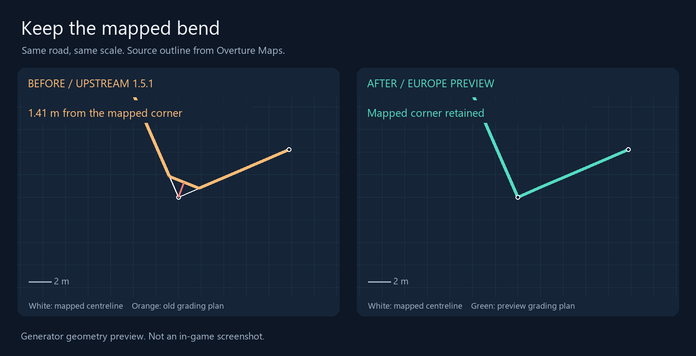
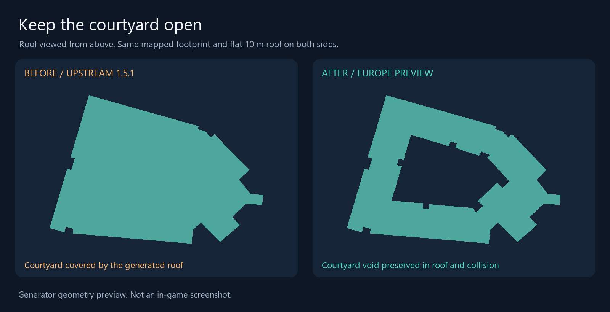

# Before and after

These comparisons show output from the world generator. They are not in-game
screenshots, a graphics benchmark or evidence of collision behaviour in a
running game.

The source is cached **Overture Maps 2026-09-23.1** data from Les Sables-d'Olonne,
France. Both panels use the same feature, view and scale. The recorded vertices
and triangles are in [fork-comparison.json](research/fork-comparison.json).

## Road geometry



White is the mapped centreline. Orange is the old ground-grading plan; green
is the preview plan. The old sampling and thinning cut across this corner,
leaving it **1.41 m** from the nearest plan segment. The preview inserts the
source corner into the plan.

The example is the largest discrepancy found in the first 200 multi-vertex
ground road parts of the cached cell containing `46.502598, -1.780002`.
Across that sample, 171 of 1,344 source vertices were over 25 cm from the old
plan. This compares the generator with its input geometry, not with an
independent survey of the real road.

## Courtyard geometry



The view shows the generated roof from above. For a controlled comparison,
both builds use the same mapped footprint, a flat 10 m roof, level ground
and a fixed appearance seed. The actual building's height and materials are
not inferred from this image.

The old generator fills the inner ring with a roof. The preview preserves
the void in the roof, coarse LOD and collision mesh, and adds inner walls.
The illustration draws the roof triangles only so the opening can be seen
without occlusion from walls.

## Reproduce the images

With the server dependencies installed:

```sh
python tools/render_comparison.py
```

The renderer reads the recorded generator output and writes the PNGs under
`docs/images/`. It does not download map data or start the game. The fixture
names the baseline and world-change commits, feature IDs and normalized inputs.
The baseline buildings and grading files match upstream 1.5.1-beta.

Map data attribution belongs to Overture Maps and its source contributors,
including OpenStreetMap. See [CREDITS.md](../CREDITS.md) for source terms.
In-game visual comparisons and long driving tests remain to be collected.
